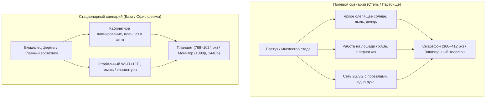
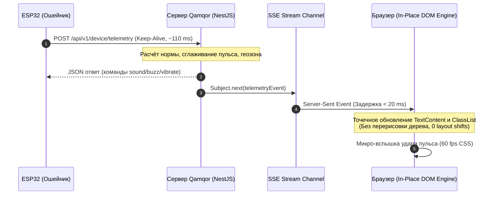
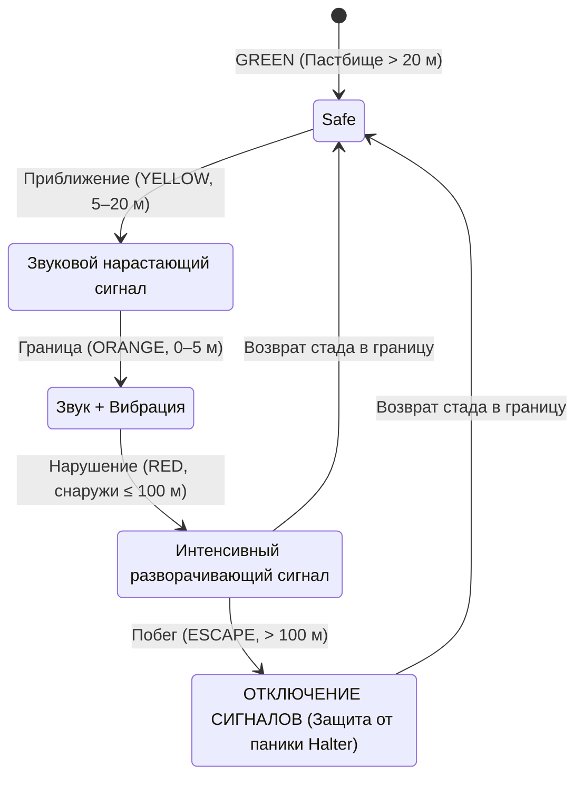

# Qamqor: Исследование и архитектурный стандарт UI/UX и Frontend (от MVP к совершенству)

> Настоящее исследование обобщает опыт мировых лидеров умного животноводства (**Halter**, **CattleEye**, **Gallagher**, **Datamars**), полевых навигационных инструментов (**onX Hunt**, **Gaia GPS**, **Flighty**) и специфику работы животноводческих хозяйств Республики Казахстан (степные условия, яркое солнце, работа верхом и на технике, перчатки, нестабильная сеть 2G/3G).

---

## 1. Контекст продукта и ключевые персоны

Система мониторинга скота и виртуального ограждения **Qamqor** обслуживает два принципиально разных сценария эксплуатации:



### Персона 1: Пастух на пастбище (Полевой оператор)
- **Условия:** Яркое солнце (засветка экрана), пыль, ветер, часто верхом на лошади или в движущемся УАЗе/пикапе.
- **Инструмент:** Смартфон среднего класса (360–412 px ширины), управление **одной рукой** (большим пальцем) в перчатках.
- **Главная задача:** Быстро взглянуть на экран (2–3 секунды) и понять:
  1. Где стадо и не ушёл ли кто-то за границу?
  2. Пульс и тревоги критических животных.
  3. Возможность одним движением подать ручной сигнал (звук/вибрацию) или найти отставшее животное.

### Персона 2: Владелец фермы / Управляющий (Командный центр)
- **Условия:** Офис фермы, жилой дом или планшет на торпеде пикапа.
- **Инструмент:** Ноутбук, десктопный монитор (1080p / 1440p) или iPad / планшет 10–12 дюймов.
- **Главная задача:** Глобальный обзор всего стада, создание и правка полигонов виртуальных загонов, анализ расхода суточных лимитов сигналов, здоровье скота по видам, распределение пастбищ.

---

## 2. Столп 1: Мобильность и полевая эргономика (Mobility & Field First)

Традиционный SaaS-дизайн (светло-серый текст `#9CA3AF`, карточки в карточках, мелкие ссылки 12 px, тонкие серые разделители) полностью «слепнет» под прямым степным солнцем. Полевой интерфейс должен проектироваться по стандартам авиационных планшетов и тактических навигаторов.

### 2.1. Контраст и видимость под слепящим солнцем
1. **WCAG AAA контрастность:**
   - Основной текст: контраст не менее **7:1** (в идеале 10:1+). Вместо чистого чёрного используется глубокий зелёно-чёрный `#0B1A12`, на тёплой подложке `#F6FAF4` он даёт контраст **13.5:1**.
   - Вторичный текст (`#31453A`) — контраст **8.2:1** (превышает даже требования к первичному тексту обычных сайтов).
   - Запрещены градиенты на тексте, размытые тени и пастельные надписи.
2. **Табличные цифры (Tabular Figures, `tnum`):**
   - Все числовые показатели (пульс, координаты, таймеры, метры до границы, RSSI) выводятся шрифтом с фиксированной шириной цифр (`font-variant-numeric: tabular-nums`). Цифры не «пляшут» по ширине при секундном обновлении.
3. **Размерные калибры ключевых индикаторов:**
   - Пульс животного: размер шрифта **36–42 px** (вес 700), считываемый с расстояния вытянутой руки при тряске в автомобиле.
   - Цветовая дифференциация только с двойным дублированием текстом: цвет (зелёный/жёлтый/красный) + текстовый статус + форма бейджа.

### 2.2. Эргономика зоны большого пальца (Thumb Zone)
В мобильном представлении 70% площади экрана недоступны для комфортного нажатия одной рукой без перехвата телефона:

```
┌─────────────────────────────────┐
│     Труднодоступная зона        │ ← Только пассивный обзор: карта,
│       (Hard to reach)           │   название загона, статус фермы
├─────────────────────────────────┤
│       Естественная зона         │ ← Информационные карточки: пульс,
│          (Natural)              │   уровень угрозы, координаты
├─────────────────────────────────┤
│       ИДЕАЛЬНАЯ ЗОНА            │ ← ВСЕ КНОПКИ ДЕЙСТВИЯ:
│         (Easy Thumb)            │   • Нижний лист (Bottom Sheet)
│                                 │   • Ручные сигналы (Динамик, Зуммер, Вибро)
│ [ Динамик ] [ Зуммер ] [ Вибро] │   • Кнопка «К стаду» / «Найти на карте»
└─────────────────────────────────┘
```

**Правила эргономики:**
- **Размер зоны касания (Touch Target):**
  - Минимум **48×48 px** для второстепенных кнопок.
  - **56 px** по высоте для главных кнопок вызова действий (Primary CTA).
  - Расстояние между кликабельными элементами — не менее **12 px**, чтобы исключить ложные нажатия в перчатках или на ходу.
- **Нижний плавающий лист (Multi-position Bottom Sheet):**
  - **Peek (96 px):** поверх карты виден статус выбранного животного (пульс, статус границы) и экстренная кнопка звукового сигнала.
  - **Half (45% высоты):** быстрые метрики, координаты, ручное управление.
  - **Full (92% высоты):** подробная история событий, физиологический профиль, журнал тревог.

---

## 3. Столп 2: Адаптивность (Responsive Architecture)

Вместо устаревших глобальных медиа-запросов (`@media (max-width: 768px)`), интерфейс Qamqor должен строиться на **CSS Container Queries** (`@container`). Каждая карточка и каждый модуль (пульс, карта, ошейник, сигналы) адаптируются в зависимости от ширины своего родительского контейнера.

### 3.1. Трехуровневая сетка адаптивности

| Устройство / Разрешение | Компоновка экрана | Поведение карты и данных |
|---|---|---|
| **Смартфон**<br>`360px – 599px` | **1 колонка (Sheet-first)**<br>Карта на весь экран, поверх неё плавающий лист данных и нижняя навигация-пилюля | Карта занимает 100% высоты. Данные раскрываются снизу вверх жестом свайпа. |
| **Полевой планшет**<br>`600px – 1024px` | **2 колонки (Split-view)**<br>Карта 55–60% ширины, панель инспектора 40–45% | Синхронная работа: тап по маркеру на карте мгновенно фокусирует карточку животного в боковой панели. |
| **Десктоп / Монитор**<br>`1025px – 2560px` | **3 колонки / Матрица**<br>Навигация слева (240px), интерактивная карта по центру, глубокая телеметрия справа | Одновременный обзор: тепловая карта пастбища, матрица здоровья всего стада, журнал оповещений в реальном времени. |

---

## 4. Столп 3: Скорость и микропроизводительность (Speed & Latency)

В полевых условиях задержка интерфейса усугубляется медленным интернетом. Если интерфейс блокируется или «лагает» на 2–3 секунды, пастух теряет доверие к системе.



### 4.1. Ключевые метрики производительности (SLO)
- **Time to Interactive (TTI):** < 1.2 с на 4G, < 2.5 с на холодном 3G.
- **Задержка обновления телеметрии:** < **150 мс** от момента генерации пакета ошейником до появления цифры на экране.
- **Cumulative Layout Shift (CLS):** **0.00**. Размеры всех блоков (бейдж угрозы, блок пульса, координаты) имеют жестко зарезервированные минимальные высоты (`min-height`) и `aspect-ratio`, предотвращая скачки верстки.
- **Размер ядра JavaScript:** < **120 КБ** gzip (без тяжелых библиотек, на чистом модульном TypeScript и MapLibre GL).

### 4.2. Оптимизация картографического движка (MapLibre GL / WebGL)
- **GeoJSON Source Diffing:** Координаты маркеров стада обновляются через метод `source.setData()` без пересоздания DOM-элементов или слоев карты.
- **GPU Marker Rendering:** Вместо сотен тяжелых HTML-элементов для каждого животного используется единый WebGL-слой точек (`circle-layer` + `symbol-layer`) с аппаратным ускорением GPU, что гарантирует стабильные **60 кадров/сек** даже при зумировании стада из 500+ голов.

---

## 5. Столп 4: Надёжность и ветеринарная безопасность (Reliability & Welfare)

Интерфейс умного ошейника — это не просто дашборд, это **система управления живыми животными**. Ошибочное или запоздалое действие может вызвать стресс или панический прорыв стада.



### 5.1. Градация свежести данных (Data Freshness Taxonomy)
1. **Свежие данные (Live, < 15 сек):**
   - Зелёная пульсирующая точка, яркие белые/зелёные цифры, активный статус связи.
2. **Устаревающие данные (Stale, 15 сек – 3 мин):**
   - Индикатор переходит в статус «Синхронизация», мягкий серый тон, вывод точного времени последнего пинга («был 45 с назад»).
3. **Обрыв связи (Offline, > 15 мин):**
   - Животное помечается статусом «Офлайн», координаты фиксируются последней известной точкой с полупрозрачным ореолом вероятного радиуса смещения, блокируются кнопки немедленного воздействия.

### 5.2. Ветеринарная безопасность Halter в интерфейсе
- **Защита от паники (Fail-Safe Escape Disarm):** При удалении животного дальше 100 м от границы автоматические звуковые и вибро-сигналы **отключаются на сервере**, а на карте отображается специальный бейдж `ESCAPE`. Интерфейс четко поясняет оператору: *«Стимуляция отключена для исключения панического бегства. Требуется участие пастуха»*.
- **Суточные лимиты сигналов:** Графический прогресс-бар показывает, насколько животное адаптировано и не подвергается ли перегрузке.

---

## 6. Дизайн-система: Токены и визуальный язык (V3 Horizon Modern)

- **`--q-primary` (`#0D4A2B`):** Глубокий степной хвойный оттенок.
- **`--q-surface` (`#F6FAF4`):** Антибликовый тёплый фон, снижающий утомляемость глаз под открытым небом.
- **`--q-ink` (`#0B1A12`):** Высококонтрастный текст с легким органическим оттенком.
- **`--q-signal-breach` (`#B52C08`):** Строгий красный для нарушений границы и критического пульса (контраст к белому > 6.3:1).
- **`--q-signal-ok` (`#0D6B3A`):** Спокойный зеленый статус безопасности и стабильной связи.
- **Иконки:** Единая библиотека Phosphor Icons regular (1.5px stroke), строго без эмодзи.

